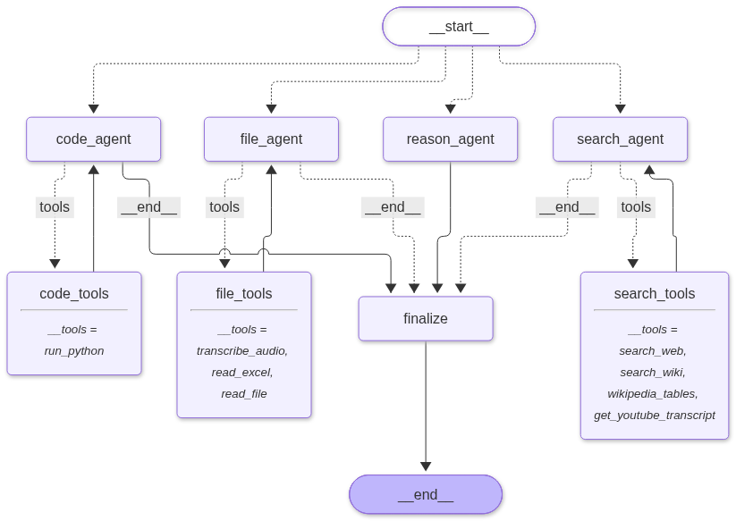

# GAIA LangGraph agent

A planner–worker agent built with LangGraph to answer questions from the [GAIA benchmark](https://huggingface.co/datasets/gaia-benchmark/GAIA). I built it for the final assessment of the Hugging Face Agents Course. My aim was an agent that splits a question into small steps, sends each step to a specialised worker with the right tools, and checks its own answer before submitting.

It is a work in progress. The tools and the worker subgraph run end to end. The planner exists, but the dispatcher, verifier and answer formatter that connect everything are still being built (see [How it can be improved](#how-it-can-be-improved)).



## Technologies

**Agent**
- [LangGraph](https://langchain-ai.github.io/langgraph/): the main graph and the per-step worker subgraph, with `ToolNode` loops for tool calls.
- [LangChain](https://python.langchain.com/): chat prompt templates and tool definitions.
- Google Gemini (`gemini-3.5-flash-lite`) through `langchain-google-genai`: planning, structured output and tool calling.
- Pydantic: typed graph state and structured outputs for the plan and the verifier's verdict.

**Tools**
- Tavily: web search.
- `wikipedia` and pandas `read_html`: Wikipedia article text and tables. The article text leaves tables out, so tables get their own tool.
- `youtube-transcript-api`: YouTube transcripts.
- OpenAI Whisper (`whisper-1`): audio transcription.
- pandas and openpyxl: CSV and Excel files.

**Observability**
- [Langfuse](https://langfuse.com/): traces of each run, filtered to drop noisy internal spans, and prompt management with a local fallback prompt.

**Data and tooling**
- Hugging Face `datasets` and `huggingface_hub`: the GAIA validation set and its attached files.
- uv for dependencies, mise for the Python and uv versions, Ruff for linting and formatting, ty for type checking.

## Features

- **Planning:** the planner turns a question, plus any attached file, into a list of typed steps (`search`, `file`, `code` or `reason`), each of which can depend on earlier steps.
- **Specialised workers:** each step type has its own agent with only the tools it needs:
  - Search: web search, Wikipedia text, Wikipedia tables, YouTube transcripts.
  - File: audio transcription, CSV/Excel reading, plain text and image reading. Image attachments are sent to the model directly.
  - Code: runs Python in a subprocess with a 30-second timeout and trimmed output.
  - Reason: no tools, for steps the model can do itself.
- **Tool errors returned, not raised:** tools return readable error messages (ambiguous Wikipedia page, missing transcript, timeout), so the worker can try again or choose another tool.
- **Tracing:** every worker run is traced in Langfuse with a session ID and tags.
- **Question loading:** fetches the assessment questions from the course API and joins them with the GAIA validation set to get file attachments.

## The process

I started on paper. In [ref/scenarios.md](ref/scenarios.md) I worked through the kinds of GAIA questions the agent would meet: reversed text, logic tables, Wikipedia lookups, multi-hop searches, YouTube videos, and audio, Python and Excel attachments. For each one I traced the tool calls that should solve it. That led to the design in [ref/pseudo_code.md](ref/pseudo_code.md): a planner that writes steps, workers that run them (in parallel when they don't depend on each other), and a verifier that can send the question back to the planner with feedback.

Next I built the tools in [tools.py](tools.py) and tested each one on real GAIA questions. Then I built the worker as its own subgraph, with one agent and one tool node per step type, so a step can call tools in a loop until it has a result. Last, I added Langfuse tracing and moved the step prompt into Langfuse prompt management, keeping a fallback in the code.

## What I learned

- When a compiled subgraph is used as a node, LangGraph copies back only the state keys that the parent and the subgraph both define. The worker state has to share `step_results` with the main state for results to come back.
- A custom reducer can do more than append. Mine treats `None` as "reset", so a re-plan can clear the old step results.
- `wikipedia`'s page text drops tables, and many GAIA answers are in tables, so a separate `read_html` tool was needed.
- Tool descriptions matter. The YouTube tool works only when the model passes the bare video ID, so the docstring says so with an example.
- LangGraph traces are noisy by default. Filtering spans such as `__start__` and `tools_condition` makes Langfuse traces much easier to read.

## How it can be improved

- Finish the main graph: a dispatcher that sends ready steps to workers in parallel using `Send`, the verifier with its retry loop, and an answer formatter that matches GAIA's exact-match rules.
- Add a runner ([run.py](run.py) is empty for now) that answers every question and submits to the course API.
- Add a page-fetching tool for questions that need the full text of a page found by search.
- Handle videos that have no transcript. These currently fall back to a best guess.
- Sandbox `run_python`. It runs model-written code in a temporary folder with a timeout, but with full access to the machine.
- Add tests. Today the tools are checked by a manual script in `tools.py`.

## Running the project

**Prerequisites:** [mise](https://mise.jdx.dev/), or Python 3.12+ and [uv](https://docs.astral.sh/uv/). You also need accepted access to the gated [GAIA dataset](https://huggingface.co/datasets/gaia-benchmark/GAIA) on Hugging Face.

```bash
mise install   # installs Python and uv from mise.toml (skip if you already have them)
uv sync        # installs dependencies into .venv
```

Create a `.env` file in the project root with these variables:

| Variable | Used for |
|---|---|
| `GOOGLE_API_KEY` | Gemini |
| `OPENAI_API_KEY` | Whisper audio transcription |
| `TAVILY_API_KEY` | Web search |
| `HF_TOKEN` | Downloading the GAIA dataset |
| `HF_ASSESMENT_API_ENDPOINT` | The course's questions API |
| `LANGFUSE_PUBLIC_KEY`, `LANGFUSE_SECRET_KEY`, `LANGFUSE_BASE_URL` | Tracing and prompt management |
| `LANGFUSE_TRACING_ENVIRONMENT` | Optional: labels traces by environment |

Then run:

```bash
uv run tools.py   # smoke-tests every tool (needs the GAIA files already downloaded locally)
uv run python -m parallel_multi_agent.worker_graph   # runs the worker on a sample question, prints the answer and redraws worker.png
```

`parallel_multi_agent/prompts.py` uses the `worker-sub-graph/step` prompt from Langfuse if it exists and falls back to the prompt in the code if it doesn't.
